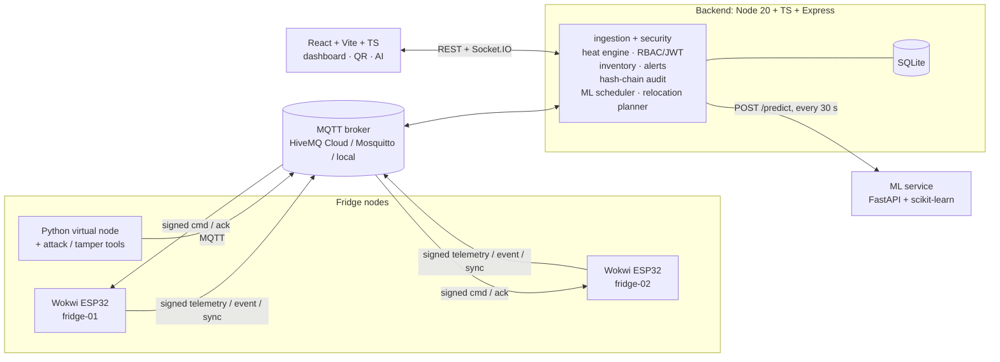

# ColdChain: Vaccine & Medicine Storage Monitor

FastRoboX 1.0 IoT Hackathon, Round 1. Vaccines and insulin lose effectiveness outside 2–8 °C. ColdChain watches every fridge, counts each batch's heat exposure, keeps the temperature safe automatically, warns before things go wrong and proves afterwards what happened.

- **Fridge nodes:** two simulated **ESP32 fridge nodes** (Wokwi) read temperature and door state, drive a hysteresis-controlled compressor relay and show status on an OLED. They buffer data through Wi-Fi loss and publish **HMAC-signed MQTT** messages.
- **Backend:** verifies every message (signature, ±30 s timestamp, nonce), tracks a **60-minute heat-exposure budget per batch**, raises alerts and keeps a **hash-chained audit log** with Verify Integrity.
- **Web app:** role-based access (Admin / Pharmacist / Inspector), a live dashboard, inventory with QR labels and a **public QR check page**.
- **AI service:** forecasts each fridge 30 minutes ahead, scores compressor health 0–100 and proposes which batches to move where. A pharmacist **confirms with one click**.

> Status: complete through P20 (integration, end-to-end scenarios, hardening, docs, one-command demo). P21 is the video brief.

## Architecture



More detail, including the life of one reading, is in [docs/ARCHITECTURE.md](docs/ARCHITECTURE.md).

## Quick start (10 minutes)

You need Node.js 20+, Python 3.11+ and Git. Docker is optional.

```bash
git clone <repo> coldchain && cd coldchain
npm run setup                                    # backend + frontend dependencies
python -m venv .venv
.venv/Scripts/python -m pip install -r ml/requirements-dev.txt -e "tools[dev]"   # Windows
# .venv/bin/python  -m pip install -r ml/requirements-dev.txt -e "tools[dev]"    # macOS / Linux
npm run env:init                                 # .env with generated JWT / app / device secrets
```

Then **activate the venv** (`.venv\Scripts\activate` or `source .venv/bin/activate`) and start the demo:

```bash
make demo        # or: npm run demo
```

`make demo` does the following and runs until Ctrl-C:
1. **Resets** the configured database (`DB_PATH`).
2. Seeds the users, both fridges and eight batches: several Safe, one at ~25 % budget, one At risk at ~12 %, and one Discard, which latches its fridge.
3. Backfills **6 hours of seeded history**, labelled as such in the UI, so charts and forecasts have context from the first minute.
4. Starts a local MQTT broker (when `MQTT_URL` is local and nothing listens there), the ML service, the backend and the web app.
5. Starts a virtual node for each fridge whose Wokwi node is not online.
6. Prints the credentials and every batch's public QR URL.

Open **http://localhost:5173** and sign in:

| Role | Email | Password (demo only) |
|---|---|---|
| Admin | `admin@coldchain.local` | `Demo-Admin-2026!` |
| Pharmacist | `pharmacist@coldchain.local` | `Demo-Pharm-2026!` |
| Inspector | `inspector@coldchain.local` | `Demo-Insp-2026!` |

Things to try:
- `python -m coldchain_tools.virtual_node --fridge fridge-01 --interactive` (`d` door, `p` power, `w` Wi-Fi), on a third terminal with demo nodes stopped (`--no-nodes`).
- `python -m coldchain_tools.attack replay --own`: watch the Security page.
- `python -m coldchain_tools.tamper --audit-id 5 --field payload`, then Verify Integrity on the Audit Log page. Undo with `--restore`.

### Docker instead

```bash
make up          # mosquitto, backend :4000, ml :8000 (localhost only), frontend :5173
npm run seed     # first time: users, fridges, devices (prints the generated passwords)
make down
```

## Running the Wokwi nodes

1. `node tools/init_firmware_config.js` writes the git-ignored `firmware/fridge-node/include/config.h` from `.env`: same broker, same device secrets as the backend.
2. Wokwi's simulated Wi-Fi (`Wokwi-GUEST`) reaches the internet but **not** `localhost`. Point `MQTT_URL` at a cloud broker, e.g. HiveMQ Cloud on TLS 8883 with a unique `MQTT_TOPIC_PREFIX`. Run `make demo` with the same `.env`.
3. In VS Code with the Wokwi and PlatformIO extensions:
   1. Run `pio run -e fridge-01` in `firmware/fridge-node/`.
   2. F1 → *Wokwi: Select Config File* → `wokwi/fridge-01/wokwi.toml`.
   3. F1 → *Wokwi: Start Simulator*.
   4. Repeat for `fridge-02` in a second window.
4. `make demo` sees the Wokwi nodes' retained `online` status and does not start virtual nodes for them.

Browser alternative and wiring are in [docs/hardware.md](docs/hardware.md#run-in-wokwi). Firmware behaviour is in [docs/firmware.md](docs/firmware.md).

## Environment

Every variable is listed in [`.env.example`](.env.example). The backend validates them at start-up and exits with a readable list of problems.

| Variable | Default | Notes |
|---|---|---|
| `MQTT_URL`, `MQTT_USERNAME`, `MQTT_PASSWORD`, `MQTT_TOPIC_PREFIX` | `mqtt://localhost:1883` | the broker every node and the backend share |
| `JWT_SECRET`, `APP_SECRET_KEY` | generated by `env:init` | ≥ 32 chars / 64 hex chars; never commit |
| `DEVICE_SECRET_FRIDGE_01/02` | generated | must match the firmware `config.h` |
| `DB_PATH` | `./data/coldchain.db` | relative to `backend/`; `make demo` resets it |
| `ML_URL`, `ML_INTERVAL_MS` | `http://localhost:8000`, `30000` | the AI loop |
| `DEMO_TIME_SCALE` | `1` | > 1 accelerates heat exposure; the UI shows a purple DEMO banner |
| `PUBLIC_BASE_URL` | `http://localhost:5173` | what the QR codes encode |
| `TELEGRAM_BOT_TOKEN` / `TELEGRAM_CHAT_ID`, `SMTP_*` | empty | optional alert channels; without them alerts go to the app and the log |

## Demo-only shortcuts (disclosed)

| Shortcut | Where it shows |
|---|---|
| `DEMO_TIME_SCALE` (heat exposure faster than real time) | purple DEMO banner on every screen |
| Seeded history (`make demo`) | grey "seeded demo history" band on charts; "seeded" in the readings table |
| Simulated nodes (`THERMAL_SPEED`, virtual nodes) | node ids and the virtual node's console |
| AI trained on synthetic data | "Trained on synthetic data" badge on the AI Report page, and the report's honesty note |

## Commands

| make | npm | Does |
|---|---|---|
| `make setup` | `npm run setup` (node only) | install dependencies |
| `make env` | `npm run env:init` | create `.env` with generated secrets |
| `make demo` | `npm run demo` | reset + seed + 6 h history, run everything, print credentials and QR URLs |
| `make test` | `npm test` | every suite: contracts, generated files, API doc, backend, frontend, ml, tools, firmware (native) |
| `make scenarios` | `npm run scenarios` | end-to-end S1–S10 and failure injection on an isolated stack (`--full` for the spec's durations) |
| `make security` | `npm run check:security` | dependency audit, secrets scan (tree and history), live security probes |
| `make perf` | `npm run check:perf` | API p95 with 2 devices + a flood |
| `make data` / `make train` | `npm run ml:data` / `npm run ml:train` | regenerate the dataset / retrain the models and the report |
| `make gen` / `make check` | `npm run gen` / `npm run check:gen` | regenerate / check constants, vectors, Wokwi projects |
| `make lint` / `make format` | `npm run lint` / `npm run format` | eslint + tsc, ruff (activate `.venv` first) |
| `make up` / `make down` | `npm run up` / `npm run down` | Docker Compose stack |
| | `npm run broker` | local MQTT broker on :1883 (no Docker needed) |
| | `npm --prefix backend run docs:api` | regenerate [docs/API.md](docs/API.md) from the route registry |
| | `npm --prefix frontend run e2e` | Playwright browser flows, including the AI flow with the real ML service |

`make test` fails when any suite fails **or has zero tests**. If PlatformIO is not installed, the firmware suite is reported as `SKIPPED`, loudly.

## Troubleshooting

| Symptom | Likely cause | Fix |
|---|---|---|
| OLED blank in Wokwi | firmware not built for that project, or the wrong `wokwi.toml` selected | `pio run -e fridge-01` and reselect the config file; the serial log says `[oled] SSD1306 not found at 0x3C` when the display is missing or miswired (SDA 21, SCL 22, 3V3; [hardware.md](docs/hardware.md#wiring-table)) |
| No MQTT messages at the backend | different broker or topic prefix on the node and the backend; Wokwi pointed at `localhost` | compare `MQTT_URL` / `MQTT_TOPIC_PREFIX` in `.env` and `config.h` (`node tools/init_firmware_config.js --force`); use a cloud broker for Wokwi |
| Security page fills with `STALE_TS` | clock skew of more than 30 s between the node and the server (no NTP, a sleeping laptop, Wokwi time) | check the **clock skew** column on the Security page; resync the clock / restart the node; NTP must reach `pool.ntp.org` |
| Every message rejected as `BAD_SIG` (signature mismatch) | the device secret differs between `config.h` and the backend, or the placeholder all-zero secret is in use | regenerate `config.h` from `.env`, and re-seed (`npm run seed`) if `.env` secrets changed |
| `UNKNOWN_DEVICE` | the node's `FRIDGE_ID` is not seeded or is disabled | `npm run seed`; check `devices.active` |
| Buffer not syncing after Wi-Fi returns | the backend is not acking: it is down, or the broker drops QoS1 acks | the node retries every 5 s and backs off after 5 tries; watch `buf=` on its serial / status line; check the backend log for `sync` |
| Fridge shows OFFLINE | no accepted message for 20 s | check the node's uplink and the Security page for rejects |
| "AI service down" / rule-based fallback labels | the ML service is not running or answers slower than 1 s | `cd ml && uvicorn app.main:app`; fallback answers keep working meanwhile |
| `make demo`: "something already listens" | a backend is already running on that port | stop it first: the demo resets its database |
| `config error` at backend start | missing or invalid `.env` values | run `npm run env:init`; the error lists each problem |

## Documentation

| Doc | What |
|---|---|
| [ARCHITECTURE.md](docs/ARCHITECTURE.md) | components, data flow, design decisions |
| [API.md](docs/API.md) | every route, who may call it, its parameters (generated) |
| [SECURITY.md](docs/SECURITY.md) | threat model, controls, what is not protected, latest check results |
| [AI.md](docs/AI.md) | forecast, health score, relocation: results and honesty note; full [report](ml/reports/REPORT.md) |
| [KNOWN_ISSUES.md](docs/KNOWN_ISSUES.md) | open issues and workarounds, checklist status P00–P20 |
| [CONTRACTS.md](docs/CONTRACTS.md) | constants, status logic, signed envelope, message bodies, pin map |
| [hardware.md](docs/hardware.md), [firmware.md](docs/firmware.md) | circuit, Wokwi, firmware modules |
| [backend.md](docs/backend.md), [frontend.md](docs/frontend.md), [ml.md](docs/ml.md), [tools.md](docs/tools.md) | per-part reference |

## Repository layout

| Path | What |
|---|---|
| `firmware/fridge-node/` | PlatformIO project (ESP32, Arduino). Envs `fridge-01`, `fridge-02`, `hw-smoke`, `native` (unit tests). Wokwi projects in `wokwi/` |
| `backend/` | Node 20 + TypeScript + Express API, MQTT ingestion, engines, scripts (seed, demo seed, broker, API doc) |
| `frontend/` | React 18 + Vite + TypeScript + Tailwind; Playwright flows in `e2e/` |
| `ml/` | dataset generator, feature pipeline, models, report, FastAPI service |
| `tools/` | `coldchain_tools`: virtual node, simulation engine, attack / tamper tools, demo stack, scenarios, security and performance checks |
| `contracts/` | `constants.json` and `test_vectors.json`, the single source of truth |
| `infra/` | Docker Compose and Mosquitto config |

## Single source of truth

Thresholds, timings and topics live only in [`contracts/constants.json`](contracts/constants.json). `python tools/gen_constants.py` writes them into the firmware, backend, frontend and ML. The test vectors (HMAC, status, exposure) in [`contracts/test_vectors.json`](contracts/test_vectors.json) are checked on every target. Never edit generated files by hand.

## Branch workflow and conventions

- One branch per prompt (`feat/00-scaffold` … `feat/20-integration-hardening`), merged to `main` when its checklist passes.
- Conventional commits: `feat:`, `fix:`, `test:`, `docs:`, `chore:`, `refactor:`.
- Secrets are never committed. `.env` and firmware `config.h` are git-ignored, and `make security` scans the tree and the history.
- No `delay()` in firmware loops; everything is `millis()`-based. Every prompt ends with tests that run in one command.

## Scope map: challenge task → prompts

| Challenge task | Covered by prompts |
|---|---|
| 1. Fridge Node | P01, P02, P03 |
| 2. Heat-Exposure Budget | P04, P11 |
| 3. Power Failure & Offline Mode | P05, P09 (sync), P12 (alerts) |
| 4. Web Application (Auth, Dashboard, Inventory, QR, Device Security, Hash-chain logs) | P07, P08, P09, P10, P13, P14, P15 |
| 5. AI Breach Prediction & Relocation | P16, P17, P18, P19 |
| Support, QA, delivery | P00, P06, P20, P21 |
