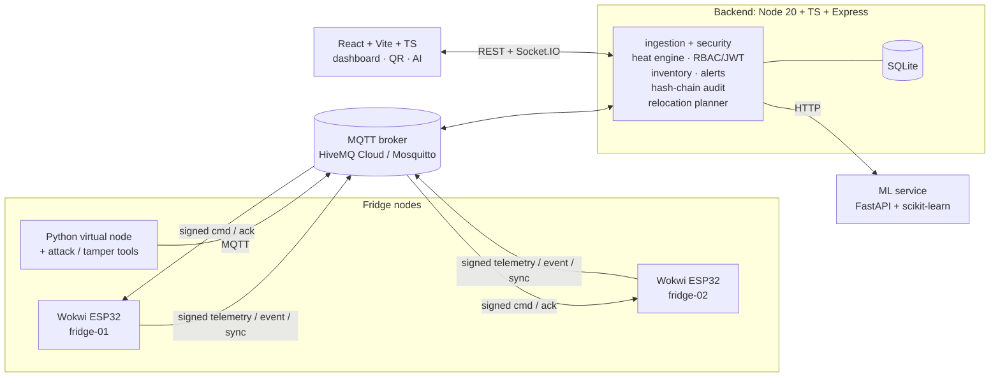

# ColdChain: Vaccine & Medicine Storage Monitor

FastRoboX 1.0 IoT Hackathon, Round 1. Vaccines and insulin lose effectiveness outside 2–8 °C. ColdChain monitors fridges, tracks each vaccine batch's heat exposure, keeps the temperature safe automatically and ships with a full web application.

Two simulated **ESP32 fridge nodes** (Wokwi) each read temperature and door state, run a hysteresis-controlled compressor relay, show status on an OLED and publish **HMAC-signed MQTT** messages. A **backend** verifies every message (signature, timestamp, nonce), stores readings, tracks a **60-minute heat-exposure budget per batch**, raises alerts and writes a **hash-chained audit log**. A **React web app** gives role-based access (Admin / Pharmacist / Inspector), a live dashboard, inventory with QR codes and a **public QR check page**. An **AI service** forecasts fridge temperature 30 minutes ahead, scores compressor health 0–100 and proposes which batches to move where, which a pharmacist confirms with one click.

> Status: **P06 virtual node, attack and tamper tools** (fridge node feature-complete, simulator and security demo tools ready). Services expose health endpoints only; features land prompt by prompt (P07–P21).

## Architecture



Wokwi's simulated Wi-Fi (`Wokwi-GUEST`) reaches the public internet but **not** `localhost`, so the default broker is a cloud broker. Local Mosquitto is for the virtual node and tests.

## Repository layout

| Path | What |
|---|---|
| `firmware/fridge-node/` | PlatformIO project (ESP32, Arduino). Envs `fridge-01`, `fridge-02`, `hw-smoke` (wiring test), `native` (unit tests). Wokwi projects in `wokwi/` |
| `backend/` | Node 20 + TypeScript + Express API (`GET /api/health`) |
| `frontend/` | React 18 + Vite + TypeScript + Tailwind |
| `ml/` | FastAPI service (`GET /health`) |
| `tools/` | Python package `coldchain_tools` (virtual node, simulation engine, attack / tamper / verify tools, see [docs/tools.md](docs/tools.md)), constant/vector generators, test runner |
| `contracts/` | `constants.json` and `test_vectors.json`: the single source of truth |
| `infra/` | Docker Compose and Mosquitto config |
| `docs/` | [Shared contracts](docs/CONTRACTS.md), [hardware](docs/hardware.md), [firmware](docs/firmware.md), [tools](docs/tools.md) and, later, API, security and AI docs |

## Prerequisites

| Tool | Version | Purpose |
|---|---|---|
| Git | latest | one branch per prompt |
| Node.js | 20 LTS or newer | backend, frontend, generators |
| Python | 3.11 or newer | ML service, tools, PlatformIO |
| Docker + Docker Compose | latest | dev broker and services |
| VS Code + PlatformIO extension | latest | firmware build (the CLI also installs via `make setup`) |
| Wokwi for VS Code (or wokwi.com) | latest | ESP32 simulation |
| `mosquitto_pub` / `mosquitto_sub` | optional | MQTT debugging |
| GNU make | optional | every `make` target has an `npm run` twin |

Accounts and services:

- **Wokwi** (free). Private Gateway (reaching local services) is a paid feature at the time of writing; check the current plan.
- **MQTT broker**, set by `MQTT_URL`:
  - **A (default):** HiveMQ Cloud free cluster, TLS on `8883`, username and password. Use a unique topic prefix, e.g. `coldchain/v1/<teamslug>-<random>`.
  - **B:** public `broker.hivemq.com:1883`, for quick tests only. Payloads are public: HMAC protects integrity, not confidentiality. Never send real data.
  - **C:** local Mosquitto from `infra/` (`mqtt://localhost:1883`, user `coldchain`, dev-only password in `infra/mosquitto/passwd.dev`).
- **Telegram bot** via @BotFather (`TELEGRAM_BOT_TOKEN`, `TELEGRAM_CHAT_ID`). SMTP email is optional. Without either, alerts still appear in the app and the logs.

## Quick start

```bash
npm run setup                 # backend + frontend node_modules
python -m venv .venv          # Python env for ml/ and tools/
.venv/Scripts/python -m pip install -r ml/requirements-dev.txt -e "tools[dev]"   # Windows
# .venv/bin/python -m pip install -r ml/requirements-dev.txt -e "tools[dev]"     # macOS / Linux
npm run env:init              # .env from .env.example with generated JWT_SECRET, APP_SECRET_KEY, device secrets
```

With `make` the first three lines are `make setup`. Then fill in `MQTT_*` (and alerts) in `.env`, and generate the firmware's git-ignored `config.h` from it (same broker, same device secrets):

```bash
node tools/init_firmware_config.js        # --force to regenerate
```

Run everything in Docker:

```bash
make up        # or: npm run up
# backend  http://localhost:4000/api/health
# ml       http://localhost:8000/health
# frontend http://localhost:5173
make down
```

Or run services directly:

```bash
npm --prefix backend run dev
npm --prefix frontend run dev
cd ml && ../.venv/Scripts/uvicorn app.main:app --reload    # bin/ instead of Scripts/ on macOS / Linux
```

The backend validates its environment at start-up and exits with a readable list of problems when anything is missing or invalid.

## Commands

| make | npm | Does |
|---|---|---|
| `make setup` | `npm run setup` (node only) | install dependencies |
| `make env` | `npm run env:init` | create `.env` with generated secrets |
| `make gen` | `npm run gen` | regenerate constants and test vectors from `contracts/` |
| `make check` | `npm run check:gen` | fail if generated files are stale |
| `make test` | `npm test` | every suite: contracts, backend, frontend, ml, tools, firmware (native) |
| `make test-strict` | `node tools/test_all.js --strict` | also fail when PlatformIO is missing |
| `make lint` / `make format` | `npm run lint` / `npm run format` | eslint + tsc, ruff (activate `.venv` first) |
| `make up` / `make down` | `npm run up` / `npm run down` | Docker Compose dev stack |
| `make seed` | `npm run seed` | seed users, fridges, devices (arrives in P07) |
| `make demo` | `npm run demo` | one-command demo state (arrives in P20) |

`make test` fails when any suite fails **or has zero tests** (vitest and pytest both exit non-zero on an empty run). If PlatformIO is not installed the firmware suite is reported as `SKIPPED`, loudly.

## Single source of truth

Thresholds, timings and topics live only in [`contracts/constants.json`](contracts/constants.json). `python tools/gen_constants.py` writes:

- `firmware/fridge-node/include/constants.h`
- `backend/src/shared/constants.ts`
- `ml/constants.py`

Test vectors (5 HMAC, 12 status, 8 exposure) are computed by `node tools/gen_vectors.js` into [`contracts/test_vectors.json`](contracts/test_vectors.json). Never edit generated files by hand. See [docs/CONTRACTS.md](docs/CONTRACTS.md) for status logic, the signed envelope, message bodies, the API surface, the permission matrix and the pin map.

## Branch workflow

- `main` holds finished, checklist-verified work. `develop` is the integration branch.
- Every prompt gets its own branch, named in the prompt (`feat/00-scaffold`, `feat/01-wokwi-hardware`, …). Run prompts in order.
- Finish the prompt, tick its checklist, run `make test`, then merge to `main`.
- **Conventional commits:** `feat:`, `fix:`, `test:`, `docs:`, `chore:`, `refactor:`. Example: `feat(backend): verify HMAC envelope`.

## Engineering conventions

- Secrets are never committed. `.env` and firmware `config.h` are git-ignored; `.env.example` and firmware `config.example.h` hold placeholders only.
- No `delay()` in firmware loops. Everything is `millis()`-based and non-blocking.
- Every prompt ends with tests that run in one command.

## Scope map: challenge task → prompts

| Challenge task | Covered by prompts |
|---|---|
| 1. Fridge Node | P01, P02, P03 |
| 2. Heat-Exposure Budget | P04, P11 |
| 3. Power Failure & Offline Mode | P05, P09 (sync), P12 (alerts) |
| 4. Web Application (Auth, Dashboard, Inventory, QR, Device Security, Hash-chain logs) | P07, P08, P09, P10, P13, P14, P15 |
| 5. AI Breach Prediction & Relocation | P16, P17, P18, P19 |
| Support, QA, delivery | P00, P06, P20, P21 |
