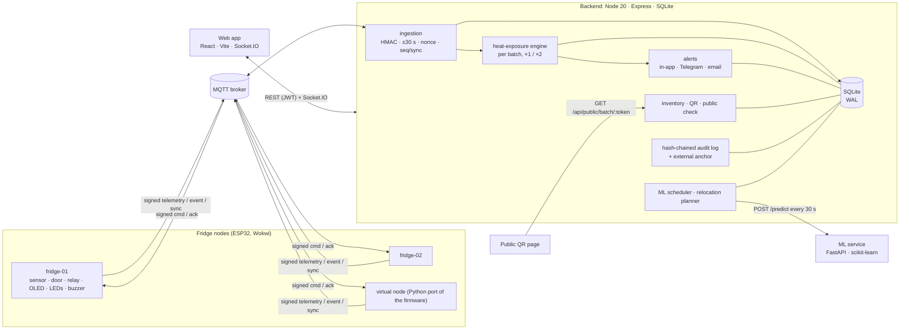

# Architecture

ColdChain monitors vaccine fridges end to end:
- sensing and control on the device;
- authenticated telemetry;
- per-batch heat-exposure accounting;
- alerts;
- a tamper-evident log;
- a web application;
- an AI loop that forecasts trouble and proposes what to move.

## Data flow of one reading

1. **Node** (every 5 s): the node reads the temperature, classifies the state (shared `classify()`), and controls the compressor (7.0 / 3.0 °C hysteresis, 60 s minimum off). It accrues its own fridge-level exposure.
2. **Envelope:** the node publishes `{v, device_id, kind, ts, nonce, body, sig}`. `sig` = HMAC-SHA256 over the canonical string with the device's secret.
3. **Offline:** when the uplink is down, the node keeps up to 720 entries in a ring buffer. On reconnect it syncs them in stop-and-wait chunks, and the server acks each chunk.
4. **Ingestion** (`backend/src/mqtt/ingest.ts`):
   - parse; known and active device; timestamp within ±30 s;
   - HMAC in constant time; nonce not seen in 120 s;
   - body schema; dedupe on `(device, seq)`.
   - A rejection is stored with its reason, pushed to the Security page and coalesced into the audit chain.
5. **Fan-out:**
   - the heat engine adds weighted exposure to every batch in the fridge (×1 above 8 °C, ×2 above 12 °C, conservative over data holes);
   - the alert engine raises door, power, breach, offline and budget alerts;
   - the realtime layer pushes `fridge:update`.
6. **AI loop:**
   - Every 30 s the scheduler sends the last hour as 1-minute buckets, plus 24 h of history, to the ML service.
   - The answer (forecast, risk level, health score) is stored, pushed and turned into alerts.
   - The planner proposes relocation plans. A person confirms them.
7. **Audit:** every state change appends to `audit_log`, where each row's hash covers the previous one. Verify Integrity recomputes the chain and compares it to the external anchor.

## Components

| Component | Code | Docs |
|---|---|---|
| Firmware (ESP32, PlatformIO, Wokwi) | `firmware/fridge-node/` | [firmware.md](firmware.md), [hardware.md](hardware.md) |
| Shared contracts (constants, vectors) | `contracts/`, generated into every target | [CONTRACTS.md](CONTRACTS.md) |
| Backend API, ingestion, engines | `backend/src/` | [backend.md](backend.md), [API.md](API.md) |
| Web app | `frontend/src/` | [frontend.md](frontend.md) |
| ML dataset, models, service | `ml/` | [ml.md](ml.md), [AI.md](AI.md) |
| Tools: virtual node, attacks, tamper, demo stack, scenarios, checks | `tools/coldchain_tools/` | [tools.md](tools.md) |
| Security model | | [SECURITY.md](SECURITY.md) |

## Decisions worth knowing

- **One source of truth.**
  - Thresholds and timings live in `contracts/constants.json`. They are generated into C++, TypeScript and Python, and checked for staleness by `npm test`.
  - Status rules and HMAC vectors are tested against the same vectors on every target.
- **The device keeps itself safe.** Compressor control, the door alarm, the red latch and offline buffering run on the node. The server adds per-batch accounting and people-facing features, but the cold chain does not depend on it being up.
- **Server time for history, device time for events.** Timestamps come from the device (NTP). Receipt time is stored next to them, so late or synced data is labelled and clock skew is visible.
- **SQLite.** A single file in WAL mode is enough for a pharmacy-sized deployment and needs no ops. Every query is parameterised.
- **AI suggests, humans confirm.** Plans are versioned, expire after 15 min and are re-validated at confirm time. Moves are one transaction, and both the plan and every move are audited.
- **Demo shortcuts are visible:**
  - `DEMO_TIME_SCALE` shows a purple DEMO banner;
  - seeded history is labelled on charts and tables;
  - `THERMAL_SPEED` exists only on simulated nodes;
  - the AI report carries a "synthetic data" badge.
