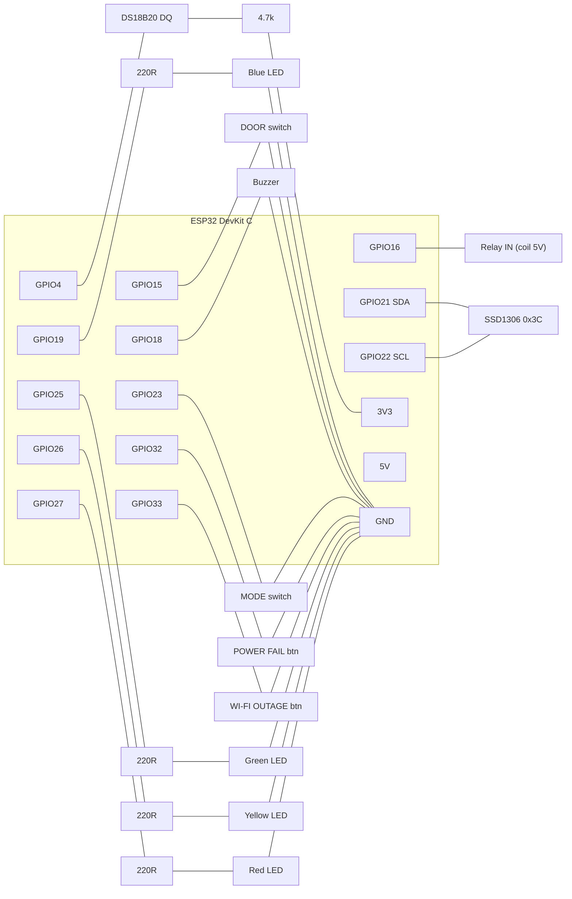

# Fridge node hardware

Each fridge has one ESP32 node. Both nodes run the **same firmware** and the **same circuit**; only `FRIDGE_ID` (a PlatformIO env), the device secret and the Wi-Fi/MQTT settings in `config.h` differ.

| Wokwi project | Runs | Purpose |
|---|---|---|
| `firmware/fridge-node/wokwi/fridge-01/` | `pio run -e fridge-01` | Fridge A |
| `firmware/fridge-node/wokwi/fridge-02/` | `pio run -e fridge-02` | Fridge B |
| `firmware/fridge-node/wokwi/hw-smoke/` | `pio run -e hw-smoke` | Wiring smoke test ([`test/hw_smoke.cpp`](../firmware/fridge-node/test/hw_smoke.cpp)) |

All three `diagram.json` files are generated by [`tools/gen_wokwi.py`](../tools/gen_wokwi.py) from one template. The GPIO numbers come from [`include/pins.h`](../firmware/fridge-node/include/pins.h), so the circuit and the firmware cannot drift apart. `make check` / `make test` fail if a generated diagram is stale, and `tools/tests/test_wokwi.py` checks every wire against the pin map below.

> Moving parts around in the Wokwi editor only changes your local copy. To keep a layout change, copy the new `top`/`left` values into `tools/gen_wokwi.py` and run `python tools/gen_wokwi.py`.

## Wiring table

| Function | GPIO | Part (Wokwi id) | Wiring | Firmware use |
|---|---|---|---|---|
| Temperature probe | 4 | DS18B20 (`temp`) | DQ → GPIO4, **4.7 kΩ pull-up DQ → 3V3** (`r_pullup`), VCC → 3V3, GND → GND | 1-Wire, async conversion |
| Door | 15 | Slide switch (`door`), label **DOOR** | common (2) → GPIO15, left (1) → GND | `INPUT_PULLUP`: LOW = CLOSED (switch left), HIGH = OPEN (switch right) |
| Compressor | 16 | Relay module (`relay`), label **COMPRESSOR RELAY** | IN → GPIO16, VCC → 5V, GND → GND | active HIGH |
| SAFE LED | 25 | Green LED (`led_green`) | GPIO25 → 220 Ω → anode, cathode → GND | on = SAFE |
| WARNING LED | 26 | Yellow LED (`led_yellow`) | GPIO26 → 220 Ω → anode, cathode → GND | on = WARNING |
| BREACH / DISCARD LED | 27 | Red LED (`led_red`) | GPIO27 → 220 Ω → anode, cathode → GND | 1 Hz blink = BREACH, solid = DISCARD latch |
| Compressor indicator | 19 | Blue LED (`led_blue`) | GPIO19 → 220 Ω → anode, cathode → GND | mirrors the relay |
| Buzzer | 18 | Piezo buzzer (`buzzer`) | + (2) → GPIO18, − (1) → GND | `tone()` |
| Power-fail button | 32 | Push button (`btn_power`), label **POWER FAIL**, key `p` | GPIO32 ↔ GND when pressed | `INPUT_PULLUP`: pressed = LOW, toggles MAINS/BATTERY |
| Wi-Fi outage button | 33 | Push button (`btn_wifi`), label **WI-FI OUTAGE**, key `w` | GPIO33 ↔ GND when pressed | `INPUT_PULLUP`: pressed = LOW, toggles simulated outage |
| Mode switch | 23 | Slide switch (`mode`), label **MODE (model/manual)** | common (2) → GPIO23, left (1) → GND | `INPUT_PULLUP`: LOW = thermal model (left, default), HIGH = manual DS18B20 (right) |
| OLED SDA | 21 | SSD1306 128×64 (`oled`) | SDA → GPIO21, VCC → 3V3, GND → GND | I²C address `0x3C` |
| OLED SCL | 22 | SSD1306 128×64 (`oled`) | SCL → GPIO22 | |

Power rails: OLED and DS18B20 on 3V3, relay module on 5V (VIN/USB). All grounds are common.

### Pin choices

- **GPIO12 is not used.** It is a boot strapping pin (flash voltage select); pulling it high at reset can stop the ESP32 from booting.
- **GPIO34–39 are not used.** They are input-only and have no internal pull-ups, so a button or switch on them would float.
- **GPIO6–11 are not used.** They drive the module's SPI flash.
- GPIO15 is a strapping pin too, but only for boot-log output: a closed door (LOW) at reset just silences the ROM boot messages. It never blocks boot.
- Every switch and button pulls its pin to **GND** and the firmware uses `INPUT_PULLUP`, so no external pull-up resistors are needed for inputs. The test suite enforces all of the above.

## Schematic



```
                         +---------------------------+
          3V3 ---+-------| 3V3                    5V |------------- RELAY VCC
                 |       |                           |
              [4.7k]     |                     GPIO23|---o/o--- GND   MODE (left=model)
                 |       |                     GPIO22|---------- OLED SCL
 DS18B20 DQ -----+-------| GPIO4               GPIO21|---------- OLED SDA   (OLED VCC=3V3)
                         |                     GPIO19|--[220]--|>|-- GND  BLUE (compressor)
 GND --o/o--- GPIO32 ----| GPIO32              GPIO18|---------- BUZZER(+) , (-) GND
   POWER FAIL btn        |                     GPIO16|---------- RELAY IN
 GND --o/o--- GPIO33 ----| GPIO33              GPIO15|---o/o--- GND   DOOR (left=closed)
   WI-FI OUTAGE btn      |                           |
 GND --|<|--[220]--------| GPIO25 (green SAFE)       |
 GND --|<|--[220]--------| GPIO26 (yellow WARNING)   |
 GND --|<|--[220]--------| GPIO27 (red BREACH)       |
                         | GND ----------------------|---- common ground
                         +---------------------------+
```

## Bill of materials (real hardware)

Per fridge node:

| Qty | Part | Notes |
|---|---|---|
| 1 | ESP32 DevKit C (ESP32-WROOM-32) | same board as the simulation |
| 1 | DS18B20 **waterproof probe** (stainless tip, 1 m lead) | probe sits in the fridge cavity, ideally in a glycol buffer bottle to read product rather than air temperature |
| 1 | 4.7 kΩ resistor | DS18B20 pull-up, DQ → 3V3 |
| 1 | **Magnetic reed switch** (normally open, door-mount kit) | replaces the DOOR slide switch; closed when the magnet is near (door closed) |
| 1 | 1-channel 5 V **relay module** with optocoupler (≥ 10 A contacts) | switches the compressor's control circuit. Mains wiring must be done by a qualified person; prefer switching a contactor coil over the compressor directly |
| 4 | 5 mm LEDs: green, yellow, red, blue | status + compressor indicator |
| 4 | 220 Ω resistors | LED series resistors |
| 1 | Passive piezo buzzer (or active 5 V buzzer module) | set `BUZZER_IS_ACTIVE 1` for an active module |
| 1 | SSD1306 0.96" 128×64 I²C OLED | check the address (0x3C or 0x3D) |
| 1 | Slide/toggle switch | MODE (or tie GPIO23 permanently, see below) |
| 1 | **3.7 V Li-ion cell** (18650, ≥ 2500 mAh) + holder | battery backup for the node (not the compressor) |
| 1 | **TP4056 charger board with protection** (DW01) | charges the cell from 5 V mains supply |
| 1 | MT3608 (or similar) boost converter to 5 V, or a 5 V power-path/UPS board | keeps the ESP32 running from the cell when mains fails |
| 2 | 10 kΩ + 20 kΩ resistors | mains-sense divider from the 5 V adapter rail to GPIO32 (replaces the POWER FAIL button) |
| 1 | 5 V / 2 A USB power supply | mains supply |
| – | Enclosure, perfboard, jumper wires, cable glands | |

The simulation buttons (POWER FAIL, WI-FI OUTAGE) exist only for the demo. On real hardware, power failure is sensed (see below) and Wi-Fi loss is real; GPIO33 can stay unconnected because its internal pull-up keeps it idle.

## Run in Wokwi

The simulated ESP32 joins Wi-Fi SSID **`Wokwi-GUEST`** (open, no password). It reaches the public internet, including cloud MQTT brokers, but **not** your computer's `localhost`. Use the cloud broker for simulated nodes (see the README).

### VS Code (recommended)

1. Install the **Wokwi Simulator** and **PlatformIO IDE** extensions. Activate Wokwi once: F1 → *Wokwi: Request a New License*.
2. Build the firmware for the project you want to run, from `firmware/fridge-node/`:
   ```bash
   pio run -e hw-smoke      # or -e fridge-01 / -e fridge-02
   ```
   Wokwi does not compile code; it runs the `.pio/build/<env>/firmware.bin` that `wokwi.toml` points at.
3. F1 → **Wokwi: Select Config File** → pick `firmware/fridge-node/wokwi/<project>/wokwi.toml`.
4. F1 → **Wokwi: Start Simulator**. The serial monitor opens in the terminal panel.
5. To run both fridges at once, open a second VS Code window on the same folder and select the other project.

### wokwi.com (browser)

1. Create a new **ESP32** project on [wokwi.com](https://wokwi.com).
2. Replace the contents of `diagram.json` with `firmware/fridge-node/wokwi/hw-smoke/diagram.json` (or a fridge project).
3. Replace `sketch.ino` with the contents of `test/hw_smoke.cpp`, and add a new file `pins.h` with the contents of `include/pins.h`.
4. Open the **Library Manager** and add: `Adafruit SSD1306`, `Adafruit GFX Library`, `OneWire`, `DallasTemperature`.
5. Press **Start**.

## Hardware smoke test

`test/hw_smoke.cpp` (env `hw-smoke`) checks every part before the real firmware exists. Everything runs on `millis()`, with no `delay()`.

| Part | What you should see |
|---|---|
| 4 LEDs | green → yellow → red → blue chase, 400 ms each |
| Relay | toggles every 2 s; serial prints `[relay] ON/OFF` |
| Buzzer | 150 ms beep every 5 s |
| OLED | full-white flash at boot, then the live test screen; a moving bar at the bottom proves the loop is alive |
| I²C | boot scan lists `0x3C`. If the OLED is missing or at another address, serial says so (a wrong address gives a blank screen, not an error) |
| DS18B20 | temperature printed every 1.6 s. In Wokwi, click the probe to change its temperature. `-127` prints an explicit "no device: check DQ and the 4.7k pull-up" message; `85` prints "power-on value" |
| Door, mode | every **raw** level change printed with the microseconds since the previous change |
| Buttons | same raw transitions (press = LOW). Bursts of changes a few µs–ms apart are contact bounce: pick the firmware debounce time (P02) from the largest burst you see |

Smoke-test checklist: all 4 LEDs ☐ buzzer ☐ relay ☐ OLED ☐ door switch ☐ POWER FAIL ☐ WI-FI OUTAGE ☐ mode switch ☐ DS18B20 ☐

## Real-hardware path

The same firmware runs on a real board: the pins stay exactly as in the wiring table, and **only `config.h` changes, with no code changes**. Copy `include/config.example.h` to `include/config.h` (git-ignored) and set what differs:

| Setting | Simulator default | Typical real hardware |
|---|---|---|
| `RELAY_ACTIVE_HIGH` | `1` | `0` for the common blue relay boards that switch on LOW |
| `DOOR_OPEN_LEVEL` | `1` | `1`: a reed switch to GND reads LOW while the magnet (door) is closed, same as the slide switch |
| `MODE_MANUAL_LEVEL` | `1` | wire GPIO23 to GND and set `0`, so the node always uses the DS18B20 probe |
| `BUZZER_IS_ACTIVE` | `0` (passive piezo, `tone()`) | `1` for an active buzzer module |
| `OLED_I2C_ADDR` | `0x3C` | `0x3D` on some modules |
| `POWER_SENSE_IS_LEVEL` | not set (POWER FAIL button toggles) | `1`: GPIO32 reads a mains-present level from a 10 kΩ/20 kΩ divider on the 5 V adapter rail (HIGH = mains, LOW = on battery). Honoured from P05 |
| Wi-Fi, broker, device secret | `Wokwi-GUEST`, cloud broker | your SSID/password, broker with a pinned CA (added in P03) |

Battery backup: the Li-ion cell (via TP4056 + boost/UPS board) powers only the ESP32, sensor, OLED and buzzer. The compressor stays on mains, which is why the firmware forces the compressor OFF on battery (P05).

The divider keeps GPIO32 within 3.3 V: 5 V × 20 k / (10 k + 20 k) ≈ 3.3 V.

## Regenerating the circuits

```bash
python tools/gen_wokwi.py          # after editing include/pins.h or the layout in tools/gen_wokwi.py
python tools/gen_wokwi.py --check  # what make test runs
```
