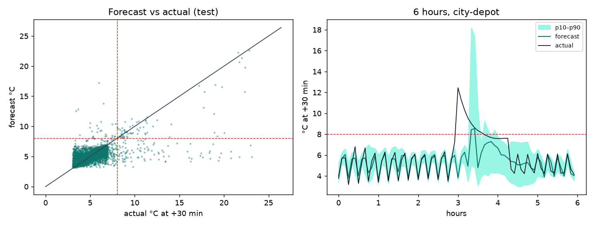
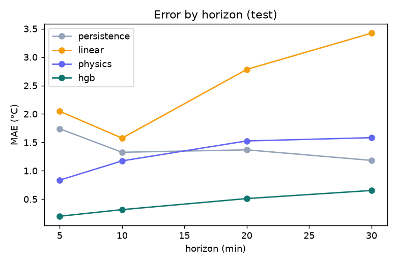
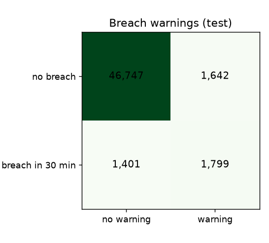
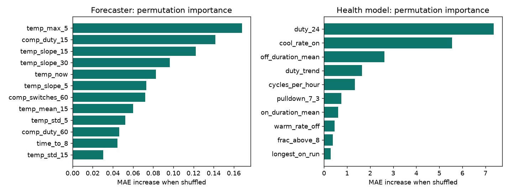
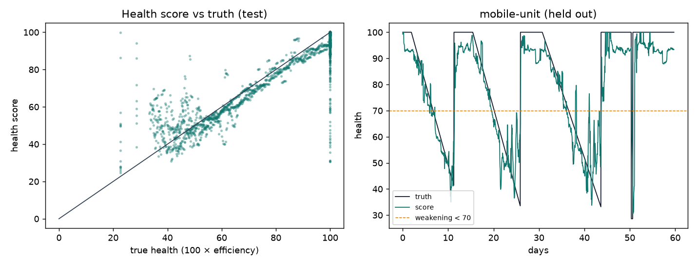

# ColdChain AI: results report

*Generated by `python -m train` on 2026-10-18 from `reports/metrics.json` (368 s).
Test split = held-out profiles (city-depot, mobile-unit) + the last 10 days of the others.*

## Dataset

8 simulated fridges × 60 days (689,595 one-minute rows) from
the simulator's own physics, with door openings, door left ajar, power failures, compressor degradation and
faults, ambient drift, noise and gaps. Breach warnings are rare: 6.2 % of test rows
have a breach within 30 min. Details: [DATASET_CARD.md](../data/DATASET_CARD.md).

## Features

42 forecast features from the last 60 minutes (temperature level / spread / slope / acceleration,
door, compressor duty and timers, power, time-to-8 °C) and 15 compressor-health features
from the last 24 h of cycles. One module (`features.py`) serves training and the API, with tests for
look-ahead, missing data and train/serve parity. Most important (permutation): forecast `temp_max_5`, `comp_duty_15`, `temp_slope_15`, `temp_slope_30`, `temp_now`; health `duty_24`, `cool_rate_on`, `off_duration_mean`, `duty_trend`.

## Models

- **Forecast (+30 min):** histogram gradient boosting predicting the median (absolute-error loss,
  `{'learning_rate': 0.05, 'max_leaf_nodes': 127}` chosen on validation MAE), with quantile models for an 80 % interval (p10–p90,
  conformalised on validation by 0.122 °C and re-ordered so they never
  cross). Random forest for comparison.
- **Breach warning:** the forecast rule (HIGH if pred > 8 or p90 > 9 °C; MEDIUM if p90 > 8 °C) against a
  calibrated classifier (class-weighted in training only, threshold maximising F2 on validation). Chosen on
  validation F2 (recall first): **classifier**.
- **Compressor health 0–100:** gradient boosting on cycle features, minus 20 × an IsolationForest anomaly signal
  trained on healthy cycles; a rule-based fallback (cooling pull vs the healthy median) under 3 cycles. Bands:
  80–100 Good, 50–79 Weakening, 0–49 Failing; *weakening* when < 70 or falling > 5 points/day.

## Results (test split)

| Forecast +30 min | MAE °C | RMSE °C | R² |
|---|---|---|---|
| **Gradient boosting (chosen)** | 0.653 | 1.236 | 0.481 |
| Random forest | 0.671 | 1.218 | 0.496 |
| Persistence T(t+30)=T(t) | 1.183 | 1.768 | -0.061 |
| Linear (15-min slope) | 3.423 | 4.583 | -6.125 |
| Physics (nominal model) | 1.583 | 2.165 | -0.591 |

The chosen model beats every baseline on MAE and RMSE.
Interval coverage 78.8 % (target 80 %; raw quantile models
67.9 %), mean width 2.11 °C.

| MAE by horizon | Persistence | Linear | Physics | Boosting |
|---|---|---|---|---|
| 5 min | 1.740 | 2.048 | 0.836 | 0.200 |
| 10 min | 1.326 | 1.575 | 1.174 | 0.316 |
| 20 min | 1.369 | 2.784 | 1.526 | 0.511 |
| 30 min | 1.183 | 3.423 | 1.583 | 0.654 |

Persistence can be worse at 5 than at 30 minutes: the 3–7 °C compressor cycle (roughly 10–20 min) brings the
temperature back round. The linear baseline extrapolates a cycle's slope and overshoots badly.

| Condition at t | Rows | Persistence MAE | Boosting MAE |
|---|---|---|---|
| normal | 41,880 | 1.088 | 0.533 |
| door open | 9,042 | 1.476 | 1.108 |
| power fail | 640 | 3.250 | 2.101 |

**Breach warnings** (3,200 breach rows of 51,589): precision 0.523, recall
**0.562**, F1 0.542, ROC-AUC 0.875, PR-AUC 0.611,
5.25 false-alarm episodes per fridge-day.

| Warning method | Precision | Recall | F1 | PR-AUC |
|---|---|---|---|---|
| rule | 0.704 | 0.444 | 0.544 | 0.533 |
| classifier (chosen) | 0.523 | 0.562 | 0.542 | 0.611 |

**Lead time** (forecast every minute, 282 breach onsets): warned before 89.0 % of
them; median 2 min, 10th percentile 1 min ahead; 15.6 %
warned ≥ 10 min ahead. Sudden causes (a door opened wide, a power cut) leave little time by nature.

**Compressor health:** MAE 3.3 points, Spearman 0.769 with true efficiency
(model alone MAE 3.3; fallback used on 0.0 % of windows).
Degradation arcs in test: 3 of 3 flagged *weakening*, median
1.0 days after onset; healthy windows wrongly flagged: 4.4 %.

| Ablation (forecast) | MAE °C | RMSE °C | Breach recall (pred > 8) |
|---|---|---|---|
| all features | 0.654 | 1.237 | 26.7 % |
| no door | 0.667 | 1.268 | 24.7 % |
| no compressor | 0.673 | 1.249 | 26.6 % |

 
 


## Limitations and honesty note

- **The data is synthetic**, from the same family of physics as the simulator. The scores above are better than
  a real fridge would give: real compressors, defrost cycles, load and sensor placement are not in it.
- The models only see what the system measures (no ambient sensor, no true efficiency). Disturbances the
  features cannot see (ambient drift, noise, faults) are what keep the errors honest.
- Warnings cannot come before their cause: a door flung open or a power cut gives minutes, not half an hour.
- Health is learned from a simulated "efficiency". Failure modes outside it rely on the anomaly signal.

## How to retrain

```bash
cd ml && python -m data.generate   # dataset (seeded), features, labels, DATASET_CARD.md
cd ml && python -m train           # models/*.joblib, model_card.json, reports/ (this file)
# real data: python -m data.export_live --db <backend db> writes readings in the same schema
```
